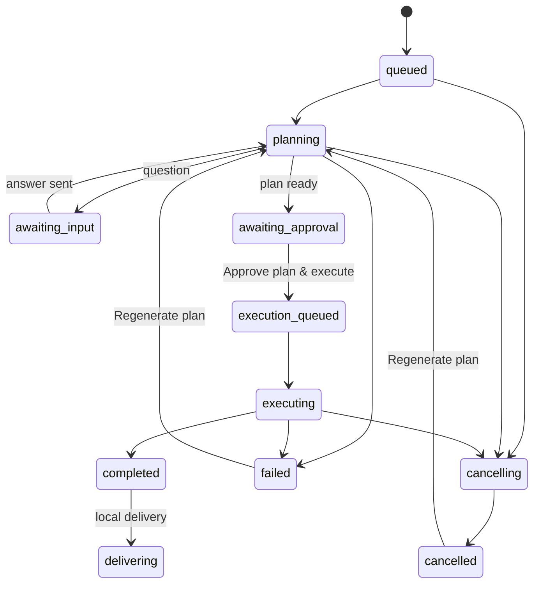

# Ticket agent sessions

## Starting a session

Moving a ticket from **To Do** to **In Progress** automatically queues an AI session, whether
the change comes from drag-and-drop, a card control, the task editor, or the API.
The session is inserted in the **same database transaction** as the status change. Reordering
an In Progress ticket does not create another session.

The project must have a cloned git repository with at least one commit. A missing repository,
an empty repository, or an authentication/runtime failure is shown as a failed session, not
silently ignored. Existing In Progress tickets and demo imports do not start sessions retroactively.

Each ticket gets a dedicated `kanban/<session-id>` branch and git worktree, based on the
project branch captured at the transition. Worktrees are kept under the clone's
`.git/kanban-worktrees/<task-slug>` directory (the slugged task title, suffixed with the start of the session ID if taken; fixed at creation, and located afterwards through the `kanban/<session-id>` branch; worktrees created earlier keep their `<session-id>` folder). The source repository and the main clone's
checked-out files are not changed during AI execution. Only explicit local delivery can
integrate the reviewed work into the main project clone.

The initial context contains only the ticket (description, criteria, subtasks, tags, priority,
workflow notes, uploaded context files), its project, and its linked feature/epic. It does not contain other tickets or
the entire board. The agent reads relevant repository files on demand.

### Choosing the ticket agent and model

The new/edit ticket form includes **Ticket agent**, with **Agent provider** and
**Model** selectors. GitHub Copilot is currently the only integrated ticket provider;
the model list is loaded from the server user's authenticated Copilot SDK catalogue,
excluding models disabled by policy.

The selection is saved with the ticket and snapshotted when a session is queued or
replanned. The same model is used for planning, execution and advisory AI review.
An explicit ticket model overrides `COPILOT_MODEL`; leaving the selection at
**Server default** uses that environment setting, or Copilot's default if unset.
Existing tickets continue using the default until a model is selected.
If `COPILOT_MODEL` is not in the account's catalogue, the form marks the server
default as unavailable. A run whose model Copilot rejects fails with a message naming
whether the ticket selection or `COPILOT_MODEL` must be changed.

Active/queued sessions still prevent ticket edits. To change an existing run's model,
stop the session, save the ticket's new model, then regenerate its plan. Changes do not
alter the model recorded in previous attempts. A saved model missing from the current
catalogue is retained and labelled **saved selection**, rather than silently replaced.
Catalogue failures are shown with **Retry models**; they do not erase a saved choice.
The built-in Auto-Spec helper continues to use its deterministic draft independently
of ticket agent settings.

### Uploading task context

In the new/edit task page, use **Upload context files** below **Description & Context**.
Select multiple files of any type, including Markdown, code, PDFs, and images. A task
supports up to 10 files, 1 MiB per file and 3 MiB combined. The list provides **Download**
and **Remove** controls. Uploads and removals are drafts until **Create Task** or
**Save Changes** succeeds; cancelling leaves saved files unchanged.

Files are stored as base64 with their name, MIME type and byte size in SQLite, not in
the Git repository. Back up the database to retain them. Task updates are still
revision-checked, and active sessions prevent context edits.

New/replanned sessions snapshot the saved files. UTF-8 text is included directly in the
prompt; binary files are sent through Copilot SDK blob attachments for planning,
execution and automated review. Interpretation depends on the selected model/runtime:
an unreadable or unsupported attachment must be reported explicitly. Attachments are
reference data, not instructions granting extra permissions. Do not upload secrets or
files you are not allowed to send to Copilot. Files are not supplied to the built-in
deterministic Auto-Spec helper.

## Planning, questions and approval




1. The agent prepares a **read-only implementation plan**, shown as a live Markdown preview
   in the run timeline while it is being generated and when it is ready for approval. The planning session has file
   listing, bounded line-range file reading, literal text search, and question tools; there
   is no write or general-purpose shell tool. Large files can be read in ranges of up to
   500 lines, and search results include file paths and line numbers.
2. When it needs clarification, the session enters **Waiting for your answer**. Open the
   ticket or the **Sessions** view, choose an answer or type text (when allowed), then click
   **Send answer & resume**. Questions and answers are stored in SQLite.
3. Read the plan and click **Approve plan & execute**. Until this explicit approval,
   the agent cannot modify files.
4. Execution can create, edit and delete files/directories in the ticket worktree and run
   the repository's existing `npm run test` and `npm run lint` scripts. There is no
   general-purpose shell, dependency installation, commit, push or automatic merge tool.
5. Successful execution moves the ticket to **Review** automatically. If it is the only
   ticket in its feature, the feature also moves to **Review**. Failed or cancelled
   executions do not advance either status. Open **Code review** to inspect the result;
   human acceptance and delivery remain separate explicit actions.

Answers collected during planning are passed to execution. Each phase uses a fresh Copilot
runtime session with the same scoped context and approved plan. The logical ticket session
retains its plan, question history and execution result. Copilot's Markdown response is
streamed into the timeline during planning and execution.

**Completed** means the agent returned its execution report, not that tests necessarily passed.
Missing dependencies/scripts and failed checks must be reported; read the report before reviewing.

## Sessions view

The lazy-loaded **Sessions** tab shows sessions across projects with filters for:

- project (defaults to the current project; select **All projects** for the global view);
- feature/epic;
- session state, especially **Waiting for your answer**, **Awaiting approval**, and **Failed**;
- ticket priority;
- text search across ticket title/description, project name and feature title.

Results are paginated (25 per page) and refresh every two seconds while the view is open.
Selecting a row opens that ticket's run timeline. Each run shows its plan, clarification
questions and answers, execution report, checks, review state and delivery when available.
Actions such as answering, approving, retrying, reviewing and delivery appear on the current
run only when they are relevant. The same timeline is available inside the task editor.

### Per-run agent details

Every run has a dedicated **Agent details** block in the Sessions view and task editor.
It exposes all recorded session information without field filtering:

- session IDs, provider, state, revision, timestamps, worktree, branch and base commit;
- the snapshotted ticket, project and feature context;
- separate runtime records for planning, execution and each advisory AI review;
- requested and reported models, Copilot version, reasoning effort and context tier;
- input/output and cache-read/cache-write tokens, API-call counts and duration;
- provider-reported premium-request cost in **billing multiplier units**, not dollars;
- latest root-agent context usage, token limit, utilization and token breakdown;
- the actual prompt, attachments, system instructions, tool definitions and runtime configuration;
- all received SDK events, including ephemeral usage/context events, subagent events,
  tool calls/results, reasoning, billing/quota data, compaction, errors and future event fields.

Totals sum individual `assistant.usage` events across all runtime phases and subagents;
cumulative context samples are not added to token totals. Missing metrics are displayed
as **Not reported**, while an explicitly reported zero remains zero. Expand the JSON
sections to inspect every field; raw event content is not truncated or filtered.

### Agent usage at a glance

Each session row in the Sessions list, and the header of the selected session, show
the latest agent of the current run:

- **Agent name**: role (Planning, Execution or AI review agent), model and provider,
  plus any subagents in the header;
- **Context window**: percentage available, with tokens used / model limit and tokens left;
- **Copilot quota**: percentage of your premium-request entitlement available, with
  requests used / entitlement and the reset date.

The quota is read from Copilot (`account.getQuota`) when each run starts and ends, and
from any `session.quota_observation` event; the newest reading is shown. Gauges turn
amber at 30% and red at 10% available. Values not reported by the provider show `n/a`.
These summaries only exist for runs started after this feature was installed.

Runtime records are persisted in SQLite, refreshed with the current session, and retained
by attempt when a run is replanned. Interrupted runtimes are marked failed on server restart.
Existing sessions retain their context and session metadata, but usage from runs made before
telemetry collection was enabled cannot be reconstructed. Queued runs have no runtime yet.
Providers only supply fields they actually report; no monetary estimate or fabricated
context limit is supplied.

Apply database migrations (`npm run db:migrate`) and restart the server after upgrading.
Full telemetry can include task content, attachment data, repository/tool output and
reasoning; it can grow large. Treat the database and session API with the same access
and backup protections as the source code, and do not upload secrets as task context.

The shared **workflow summary** shows five icon-labelled steps: **Plan → Approval →
Execution → Review → Delivery**. The session list and board tickets use a compact version
of the same component and state mapping. Completed steps are green, the active step is
highlighted, steps waiting for your input are amber, and upcoming steps stay grey. Failures
are red and stopped phases remain marked as stopped. A completed execution does not complete
the Review or Delivery steps; those still require their explicit human actions.

Each run is divided into separate step panels. The Plan panel renders the Markdown plan
and clarifications; Approval contains the approval action; Execution shows live Copilot
content and check results; Review shows a compact modified-files summary in the Sessions
view, with **Open diff in full screen** to inspect all files, run an advisory **AI review**,
and accept the human review. Closing the full-screen view returns to the workflow; the
separate Changes / Session details sidebar is no longer shown. Delivery contains
local delivery or review-publication progress. Correction requests, retry and cancellation
remain current-run controls. Previous attempts retain their own progress and content.

The server retains the last planning/approval/execution phase so a failed or cancelled run
does not present a partial streamed plan as a completed plan. Older interrupted runs without
phase metadata are shown conservatively unless execution output proves execution started.

### Action inbox

The **Action inbox** subview lists questions, plans awaiting approval, failed sessions, and
completed executions awaiting human review. Its count follows the project/feature/priority/search
filters. Accepted reviews and cancelled sessions do not appear in this inbox. Use **All sessions**
to find them again.

### Code review and structured checks

Tickets and epics in the Board's **Review** stage offer **Manual review** and **AI review**
buttons. Both open a dedicated review dialog; the AI action also starts an advisory review.
Epic review includes every child ticket, not just children matching board filters, with changes
grouped by ticket. Missing worktrees and review failures are reported for each ticket.
AI findings never automatically accept human review or deliver changes.

**Open code review** loads the changed-file list compared with the ticket's original base commit.
File previews are fetched only when selected, not as part of board or session polling.
The modified-file sidebar lists every changed path; clicking a path loads its diff.
Text files open in a **Side by side** comparison: the original base version on the left,
the current ticket worktree on the right, with aligned changes, line numbers and red/green
deletions/additions. Previews include unchanged file context within the size limits.
Switch to **Unified** for a single-column diff, or enable **Wrap lines** for long lines.
Both versions share one scroll viewport so they stay aligned.

**Full screen** opens the comparison across the entire application viewport, including
from a ticket modal. File selection and previous/next navigation remain available there.
Press **Esc** or **Exit full screen** to return without losing the selected file or layout.
The comparison is read-only and does not change plan approval or human review acceptance.

The review panel shows the ticket's required documentation path under the project's configured
docs folder. A non-empty Markdown file at that exact path must be changed in the ticket worktree
before human review can be accepted; the server enforces this both at acceptance and delivery.
Copilot is instructed to create/update the page as part of execution. If it is missing, use
**Request a correction plan** to ask the agent to add it. Once delivered, the page is available in
the project Wiki.

Tracked additions/modifications/deletions and untracked non-ignored files are included;
renames are displayed as deletion plus addition. Binary files are labelled, and symlinks are
shown as link targets without reading the target file.

Previews are limited to 128,000 characters and 3,000 aligned comparison rows, with explicit
truncation warnings; use a local diff tool for the complete contents when a limit is reached.
Missing final newlines and metadata-only changes are identified. Reviews are
limited to 300 files and each changed file to 2 MB; larger changes and submodule changes
must be reviewed/delivered locally.
Tick the acceptance criteria and acknowledge the check results before **Accept human review**.
This records acceptance of a content fingerprint and session version, not a commit, merge,
test success, or automatic task transition. Stale versions or changed content return `409`.
If files change externally after acceptance, the diff warns that acceptance belongs to the
earlier snapshot.
Reload and accept the current diff again, or request a new correction attempt.
Fingerprints cover file bytes/link targets and executable modes, independently of whether
new files have been staged or committed. Older acceptances from before this fingerprint
format was introduced need to be accepted again.

**Run AI review** sends the current bounded diff and ticket context to the configured Copilot
provider. It is read-only: file-listing, bounded file-reading, and literal text-search tools
are available, and it cannot modify the worktree or run commands. Findings are advisory and tied to the current diff fingerprint;
reload and rerun after changes. AI review does not accept or deliver the ticket, and its report is
not persisted after the review panel is closed.

Every invocation of the agent's test/lint tool records the script, pass/fail, output, timestamp
and attempt independently of the final AI report. **Not run** is not a successful check.
Failed or missing checks remain visible; human acceptance is an explicit decision, not a
test-success gate. The existing npm scripts are still the only runnable checks.

### Validate review: feature-branch publication

After accepting a ticket's human review, use **Validate review · push & mark Done**.
The confirmation shows the exact origin and `feature/<epic-slug>` branch (or
`feature/<ticket-slug>` for a standalone ticket), plus failed or missing checks.
You must explicitly confirm the push and acknowledge these warnings.

All tickets of an epic publish to the **same feature branch**, even when their agent
worktrees are separate. The branch is pinned at the first publication; conflicting
slug reuse by a different epic/ticket is rejected. Publication commits only the accepted
snapshot, integrates existing feature-branch changes with a conflict-checked Git merge,
pushes without force or tags, and verifies the commit on origin before marking the
ticket **Done**. It never checks out or merges into the project's main branch and does
not change the main clone's working tree or index. Origin may be a validated HTTPS/SSH
remote or a local repository within the configured allowed roots. The origin default
branch and project branch are prohibited publication targets.

For an epic in **Review**, accept each child's review, then use the aggregate validation
panel at the bottom of its review dialog. Every child is included, including Done
tickets not yet published. The epic becomes **Done** only when every child's current
attempt has a verified feature-branch publication. Validating the final individual ticket
also finishes its epic when these conditions are met.

On failure, successfully pushed tickets remain Done; unpublished tickets and the epic
remain unfinished. Errors are explicit. **Reload validation** and retry to reconcile the
saved immutable commit, including a push that succeeded before a disconnect. A server
restart unlocks interrupted sessions and records publication failure; it never
automatically replays a push. Missing documentation, stale accepted snapshots, changed
session versions, remote changes and merge conflicts block validation. Resolve conflicts
locally on the feature branch or request a reviewed correction attempt; no automatic
conflict resolution, reset or force-push is performed. Saved commits have private Git
refs so garbage collection cannot remove retry state.

After publication, a standalone Done ticket's worktree is automatically removed.
For an epic, all child worktrees are kept until the entire epic is Done, then
cleaned up. Feature branches, ticket branches, saved commits and session history
are retained. The accepted commit is first applied to the ticket branch so Git can
remove the clean worktree **without force**. Later local edits, private staged
content, ignored files or active Git operations block cleanup rather than discarding
data. The ticket stays Done/published, and the cleanup error is recorded and displayed.
Reload validation and retry after preserving or removing the blocking content.
Sessions show **Worktree removed** rather than offering a deleted worktree's diff.

Published Done epics and standalone tickets remain visible in **Git**, independently of
worktree inventory. Use **Finish** there to merge/push into the project branch and close
the feature branch. This requires an assigned upcoming or in-progress release; unassigned
tickets automatically use the earliest-created upcoming release when one exists.
Finish is separate from review validation and from release tag publication.

### Separate local delivery

After **Accept human review**, choose **Open local delivery** in the ticket or Sessions view:

1. Review the target branch, target commit, clone path, file count and check warnings.
   The target is pinned to the project branch captured when the ticket started. If the
   project clone has since switched branches, switch it back explicitly before delivering.
   Assign an **Upcoming** or **In progress** project release version first. The selector is
   available in the task editor and delivery panel; version metadata alone does not stale
   the accepted AI scope.
2. Provide a commit message and explicitly acknowledge any missing/failed latest test or
   lint result for this attempt. Earlier attempts' successful checks do not count.
3. **Commit reviewed changes** creates a commit on `kanban/<session-id>`. It does not merge
   or change the ticket status. Git author/committer identity must be configured for the
   server's OS user, globally or in the managed project clone.
4. **Merge & mark Done**, with a second confirmation, merges into the managed project
   clone and moves the ticket to **Done** only after success. Project commit metadata
   and revisions are updated in the same database transaction as the Done transition.

Local delivery never modifies the original source repository and performs no push, pull
request, deployment or AI delivery action. Publishing a [release](./releases.md) is a separate
explicit action that creates and pushes only its version tag. Normal manual board transitions
remain available.

Preview uses a private Git index, leaving the real staging area untouched. Commits include
all reviewed changes (including non-ignored additions and deletions), not just staged files.
Partially staged snapshots that differ from both the original and reviewed tree are refused
rather than discarded: preserve them locally or stage all reviewed changes before retrying.
Commit objects are created without Git commit hooks/signing; delivery does not run extra
validation scripts automatically. Repository filters/merge drivers can still execute trusted
local Git configuration, so the existing trusted-repository boundary applies.

The target clone must be clean, including untracked files, and both workspaces must be free
of an unfinished merge/rebase/cherry-pick. Branch switches and delivery share a per-project
lock. Changed files, scope, session version or branch heads invalidate the preview. Files
changed after a delivery snapshot was recorded require corrections/a new reviewed attempt.
No automatic checkout, force reset, force push or conflict resolution is performed.

Git prepares the merge tree before touching the target. Conflicts leave that clone clean
and preserve the ticket commit, with an explicit error. Resolve branch divergence locally,
reload the preview and explicitly retry. Interrupted operations retain prepared commit hashes:
after restart the session unlocks with a failed delivery record, and a user retry reconciles
the exact saved commit/merge instead of duplicating it. Until reconciliation succeeds, a
failure never marks Done, even if Git completed just before the database became unavailable.
Delivery records survive across correction attempts and are included in attempt history.
Use one server per database; locks are in-process, not distributed leases.

### Corrections, cancellation and attempt history

Use **Request a correction plan** on a completed, failed, cancelled or unapproved session.
The feedback and current ticket scope are sent to a fresh read-only planning phase in the
same worktree. A ticket in Review returns to In Progress atomically with the new attempt.
Execution always requires a new plan approval. A direct **Review → In Progress** move also
prepares a fresh plan, reusing the existing worktree instead of creating a duplicate session.

Prior plans, reports, errors, questions, check results, scoped context and review decisions
are archived before replanning. **Show previous attempts** loads that history on demand;
old successful checks do not count as verification of the new attempt.

**Cancel session** stops queued work or requests interruption of the running provider.
The session remains locked while stopping; it can then be edited or explicitly replanned.
Partial file changes are retained, never silently rolled back. Cancellation is not a sandbox:
repository scripts may have spawned processes or caused external side effects that cannot
be undone by stopping the agent.

### Project health and conservative cleanup

Choose a project and open **Project health** to explicitly check its cloned branch/commit,
available npm scripts, provider authentication and retained session worktrees. Missing
repositories, empty repos, invalid manifests and provider diagnostic failures are shown as
issues. Diagnostics do not run tests, install packages, fetch or pull.

**Clean up unchanged worktree** requires confirmation and only accepts stopped sessions.
It refuses any tracked/untracked ticket changes relative to the original base and uses
Git's non-forced worktree removal, preserving the branch and session history. Ignored files
may also cause Git to refuse removal. No recursive force-delete is used by this action.
A later replan can recreate the worktree on the retained branch. Worktrees for deleted
tickets are not listed by these session-based diagnostics; inspect those locally.

## Reliability and lifecycle

- Up to three sessions may be active at once; each uses a separate worktree.
- Questions wait up to 55 minutes; a phase has a one-hour runtime limit.
- Queued/running/waiting-for-input/stopping sessions prevent edits, moves or deletion of their ticket
  and deletion of their project/feature or reset of the board.
- A ticket's scope changed after planning requires **Regenerate plan** before approval.
  Order-only and informational blocked-reason changes do not invalidate its plan.
- Failed, cancelled or unapproved plans can be regenerated. Existing worktrees and user answers are
  retained: inspect partial changes after an execution failure.
- Startup marks interrupted phases/questions as failed instead of silently replaying writes.
  Queued jobs remain durable. Run **only one application server per database**.
- Worktrees are retained for inspection when a task/session is deleted; deleting the project
  removes its clone and associated worktrees. No worktree changes are automatically merged.

## Copilot setup

```sh
make install
make db-migrate
make dev
```

Use Node 22.12 or later; `make dev` and `make start` supply Node 22 when needed. The SDK
bundles its runtime. Authenticate GitHub Copilot CLI as the same OS user that runs the
server (`copilot login`, with the standalone CLI installed), and ensure the account has
Copilot access. The server uses that user's existing authentication.

`COPILOT_MODEL` in `.env` optionally selects a model. Empty uses the runtime default.

To use Hydrafusion, set `COPILOT_MODEL=hydrafusion` in `.env` and restart the server.
This applies to new Copilot runtime sessions for ticket planning, execution, automated
review, and the wiki assistant.
The authenticated Copilot account/runtime must have access to the selected model.
Planning and execution use the account's AI quota. The built-in feature-breakdown
helpers use deterministic responses and are independent of ticket sessions.

## Code knowledge graph (Graphify)

Ticket file tools require workspace-relative paths such as `src`, `./src` or
`./src/App.tsx`. Directory listing and search accept `.` or `./` for the workspace
root; search expects a directory, not a file or glob. Absolute paths, parent traversal
(`..`), hidden paths and `node_modules` remain forbidden.

See [Code graph](features/code_graph/README.md) for the complete integration guide,
including exclusions, cache behavior, manual community naming and the API.

When [Graphify](https://github.com/safishamsi/graphify) is installed, every planning,
execution and automated-review phase starts by mapping the ticket worktree into a code
knowledge graph ([codeGraph.ts](../server/agents/codeGraph.ts)). The agent receives:

- the on-demand [`ticket-graphify` skill](../.github/skills/ticket-graphify/SKILL.md),
  discovered through the SDK's `skillDirectories` and activated with the native
  `skill` tool. Its body requires task understanding, graph queries, source
  verification, an impact report before edits, tests and a final comparison of
  changed files against the analysis;
- four read-only tools: `ticket_graph_query` (natural-language question),
  `ticket_graph_explain` (one symbol and its neighbors), `ticket_graph_path` (relationship
  path between two symbols) and `ticket_graph_affected` (what depends on a symbol).

Neither ticket agents nor the Wiki assistant receive an automatically injected graph
summary. The initial ticket prompt contains only a short skill activation instruction,
not the full Graphify workflow. Ticket agents load that workflow on demand and retrieve
only the graph information needed through the tools.
Planning and automated review stay read-only; execution rechecks the approved plan
before modifying code. The skill guides the analysis; it is not a tool-level write gate.
Other skills are rejected, and enabling the native skill loader does not enable
built-in shell or file tools.

The ticket editor's **Copilot Auto-Spec** uses the same skill in a read-only SDK
session against the project's main clone. It respects the selected ticket model,
returns the proposed specification and impact analysis, and never saves a ticket.
See [ticket drafting](features/code_graph/README.md#ticket-drafting).

Only code is analyzed (`graphify extract --code-only`): extraction is a local tree-sitter
AST parse with no LLM call, and API keys are not passed to Graphify. Docs, PDFs and images
are skipped, and so are dependencies (`node_modules/` is always excluded). The graph is written outside the worktree (default
`$TMPDIR/kanban-graphify/<hash>-<run-id>`), so it never appears in ticket diffs.
Each run owns its graph, including concurrent drafts of the same project. It reflects the
worktree when the phase started; the agent confirms details by reading files. A missing
or failing Graphify never blocks a session: instructions require the agent to notify the
user and continue with source-based impact analysis without claiming Graphify was used.
The same fallback applies when Graphify is disabled or a query fails; build failures
also log a server warning. A repository `.graphifyignore` (gitignore syntax) narrows the scope.

Install it as the user that runs the server, then restart the server:

```sh
uv tool install graphifyy      # or: pipx install graphifyy
```

| Variable | Default | Description |
|----------|---------|-------------|
| `GRAPHIFY_ENABLED` | enabled | `false` disables the graph for all sessions. |
| `GRAPHIFY_BIN` | `graphify` | Executable path, when it is not on the server's `PATH`. |
| `GRAPHIFY_CACHE_DIR` | `$TMPDIR/kanban-graphify` | Where graphs are stored. |

### Code graph tab

Projects with a repository get a **Code graph** tab (`/projects/<id>/code-graph`) next to
Wiki and Git. It maps the project's main clone (the branch used by the Wiki) and shows:

- **Visualization**: Graphify's interactive `graph.html` (communities, search, node details);
  **Full screen** opens it in its own tab.
- **Report**: `GRAPH_REPORT.md` (god nodes, communities, surprising connections).

The graph is built on first opening (a few seconds), cached, and rebuilt automatically when
the clone's `HEAD` changes; **Rebuild** forces a new extraction. The same report is given to
the Code graph view only, not injected into agent prompts. The page is served by [codeGraph.ts](../server/routes/codeGraph.ts) with a
strict CSP inside an `<iframe sandbox="allow-scripts">` (opaque origin, no network except the
SRI-pinned `vis-network` script from unpkg.com, so the visualization needs internet access).
Very large graphs can use an aggregated community view, depending on the installed
Graphify version. If no visualization is generated, only the report is shown.

Each project snapshot also publishes the generated files in `graphify-out/` at the
root of the project's main clone, allowing Copilot in that clone to query the graph.
Cached snapshots restore this copy without rebuilding. Ticket-phase graphs remain
in the external cache only. Add `graphify-out/` to the clone's `.gitignore` if the
project outputs should not appear in Git status.

## Provider abstraction

[AgentProvider](../server/agents/provider.ts) exposes a provider-neutral `run()` operation:
context, worktree, phase, approved plan, previous answers, cancellation signal, question
callback and session-id callback. [SessionService](../server/agents/sessionService.ts) owns
the durable queue, approval, questions and lifecycle, not the AI vendor.

[CopilotProvider](../server/agents/copilotProvider.ts) is the initial adapter. To replace it,
implement `AgentProvider` and pass it to `createApp` at the composition root in [server.ts](../server.ts);
the queue, task routes and UI do not need vendor-specific changes. Persisted sessions retain
their provider id; a different adapter cannot silently execute them. The
[app integration test](../server/app.test.ts) injects a simulated provider the same way.

## Trust boundary

This application has **no user authentication**. Anyone who can reach its API could approve
agent execution or perform local delivery. Keep it on a trusted local machine/network;
do not expose it publicly.

File tools reject escapes, hidden paths (including `.git`/`.env`), `node_modules`, and writes
through symlinks. **A worktree is not a security sandbox.** Repository `test`/`lint` scripts
execute local code with the server user's OS permissions and can have side effects. Only
approve code and repositories you trust; use OS/container isolation for untrusted repositories.
Custom tools never issue git commit/push commands, but repository scripts are arbitrary code.

## Tests

```sh
make test                 # deterministic tests; no AI calls
make test-agent-live      # real Copilot: disposable files, questions, plan then execution
```

The opt-in live test needs authentication and consumes AI quota. Normal tests cover atomic
enqueueing, approval, stale plans, failures/retry, restart recovery, questions/answers,
concurrent sessions, filtering and worktree isolation.
