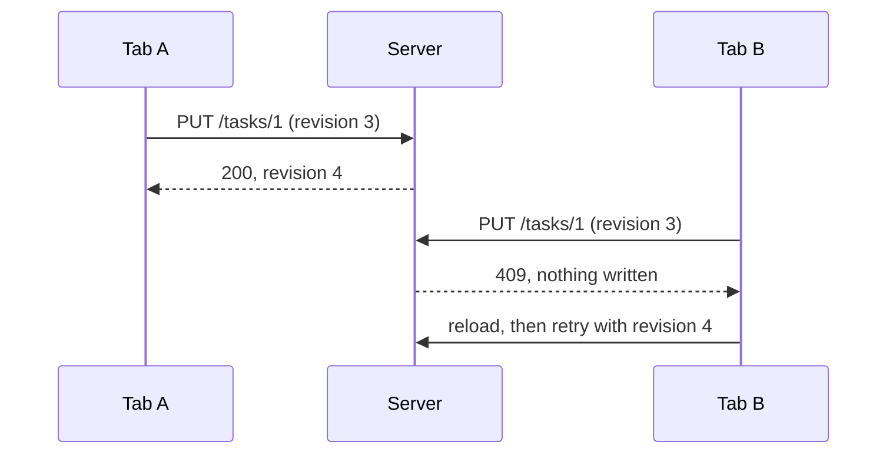

# Architecture

The app is an Express server that serves a React 19 + Vite frontend, deterministic Copilot
assistance endpoints, and a Prisma-backed board API. [server/app.ts](../server/app.ts) (`createApp`)
composes the API from injected dependencies (database, git workspaces, agent provider, code graph)
without listening or starting background work. [server.ts](../server.ts) is the entry
point: it builds the production dependencies from the environment, adds Vite or static file
serving, listens, then starts and stops the release and agent-session services. Code is split
into small modules so each change needs only a narrow context.

## Client / server boundary

- `src/` contains browser code; `server/` contains API, persistence and runtime code.
  Neither imports the other in production.
- [shared/types/](../shared/types/) owns domain types and Zod contracts.
  [shared/utils/](../shared/utils/) owns the pure Kanban rules, agent workflow and telemetry
  helpers used by both sides. Shared production modules do not depend on either application layer.
- [shared/data/initialData.ts](../shared/data/initialData.ts) contains the demo seed, imported
  only by the server and tests, never by production browser code. There is no shared barrel
  re-exporting the seed alongside contracts.
- On an empty database, the browser posts only its existing legacy localStorage collections
  to `/initialize` in a `{ legacy: { projects?, features?, tasks? } }` envelope. The server
  fills absent collections from the seed, normalizes legacy links and validates the result.
  Full board imports retain their existing strict validation. Reset also uses the server seed.
- [module-boundaries.test.mjs](../scripts/module-boundaries.test.mjs) checks the import
  boundary and the browser bundle's module graph, including lazy imports.

## Frontend: dynamic loading

[App.tsx](../src/App.tsx) uses React Router for project-scoped view URLs and
browser history. [TaskPage.tsx](../src/components/TaskPage.tsx) independently
loads the owning project board for dedicated new/edit task routes in the current
tab, reusing [TaskModal.tsx](../src/components/TaskModal.tsx) in a non-modal layout.
Successful saves and cancellation return to the originating project/view stored
in router state, or to the owning board for direct links. The workspace remounts
and loads fresh data. Failed saves keep the editor and draft open.

```
App.tsx
 ├─ useProjects()               → GET /api/board/projects (summaries + stats only)
 └─ <Suspense>
     └─ lazy(CockpitView)     → action summaries + release metadata, auto-refresh
     └─ lazy(KanbanBoard)       → separate JS chunk, loaded on demand
         └─ useBoard(projectId) → GET /api/board/projects/:id/board in a useEffect
```

- [App.tsx](../src/App.tsx) loads only the project list. Project cards and the switcher use
  server-computed `stats` instead of all tasks.
- [CockpitView.tsx](../src/components/CockpitView.tsx) is the default, lazy-loaded landing
  view. It requests paginated action summaries and release metadata, not full session plans,
  ticket bodies, or all-project boards; only the selected ticket's project board is loaded
  when the user opens a ticket.
- [KanbanBoard.tsx](../src/components/KanbanBoard.tsx) is loaded with `React.lazy` and shown
  with a `Suspense` fallback, so the board code is not in the initial bundle.
- [useBoard.ts](../src/data/useBoard.ts) fetches the selected project's features and tasks in an
  effect. Switching projects aborts the previous request (`AbortController`), so stale
  responses never overwrite the current board.

## Atomic, entity-by-entity persistence

Each user action persists **only the entity it changes**, in its own transaction:

| Action | Request | Transaction scope |
|--------|---------|-------------------|
| Edit a task | `PUT /tasks/:id` | That task and its subtasks |
| Move a card | `POST /tasks/:id/move` | That task's status and column order |
| Enter In Progress | Move or edit task | Status change plus its durable agent session, in one transaction |
| Edit a feature | `PUT /features/:id` | That feature |
| Delete a feature | `DELETE /features/:id` | The feature, plus unlinking its tasks |
| AI breakdown | `POST /breakdown` | The feature and its generated tasks, all or nothing |

- [useOperation.ts](../src/data/useOperation.ts) tracks pending/error state **per operation**, so
  one component's failure or spinner does not reset another component's state (open modals,
  form input, selection).
- Local state is updated from the server response, which carries the new `revision`.
- [entityStore.ts](../server/db/entityStore.ts) implements the transactions;
  [boardStore.ts](../server/db/boardStore.ts) handles only initialization and reset.

## Ticket execution

[TicketOrchestrator](../server/agents/ticketOrchestrator.ts) replaces single-provider
dispatch behind the [AgentProvider](../server/agents/provider.ts) application port.
It routes each phase to the runtime captured with the ticket, without fallback:
[CopilotProvider](../server/agents/copilotProvider.ts) remains the default and
[ClaudeTicketProvider](../server/agents/claudeTicketProvider.ts) is experimental and
disabled until explicitly activated with a dedicated API key. Shared
[ticketSession](../server/agents/ticketSession.ts) definitions own business tools and
instructions; SDK adapters translate them to native tools or in-process MCP. The
[session service](../server/agents/sessionService.ts) polls durable jobs, prepares per-ticket
worktrees, persists questions and answers, and waits for plan approval before enabling writes.
[SessionsView](../src/components/SessionsView.tsx) and the task session panel are lazy-loaded;
list queries return paginated metadata without full ticket contexts or plans.
See [agent sessions](./agent-sessions.md) for permissions, lifecycle and setup.
The [multi-provider orchestrator proposal](./ai-orchestrator.md) describes a provider-neutral
target contract and an incremental migration path. Its first Core slice is implemented under
[server/agents/core/](../server/agents/core/) but is not yet wired into the ticket-session runtime.
Its [read-only analysis runner](../server/agents/core/analysis.ts) is tested offline with
an immutable text workspace snapshot, host-controlled tools and a scripted fake provider.
The separate [Copilot analysis adapter](../server/agents/adapters/copilotAnalysisProvider.ts)
uses an empty runtime, ephemeral persistence, and only the canonical broker tools.
It refuses unqualified SDK/runtime/model combinations; offline tests do not establish
production confinement. Canonical tool IDs are translated to runtime-compatible aliases;
a pre-model RPC inventory check rejects ambient configuration or unexpected tools.
`make test-analysis-native` exercises these boundaries with the real runtime inside
bubblewrap, without network, credentials or model calls. The separate opt-in
`make test-analysis-live` observes active model output, aborts the real SDK session,
and verifies runtime child exit; it shares the host network and uses AI quota.
Neither test automatically grants model-specific production qualification.
The separate [Claude Code analysis adapter](../server/agents/adapters/claudeAnalysisProvider.ts)
implements the same Core port through in-process MCP snapshot tools. It requires explicit
Anthropic API credentials and SDK/runtime/model qualification, disables ambient settings
and built-in tools, and checks hook registration and runtime inventory. Its offline tests
use a simulated runtime transport, a real in-memory MCP exchange and an inert Node child;
they do not start Claude Code, prove native confinement or make model requests.
`make test-analysis-claude-native` separately probes the installed runtime inside bubblewrap
without external network or real credentials: hook registration, MCP inventory,
hostile fixture exclusion and idle-process abort. Synthetic turns against an isolated
loopback SSE fixture demonstrate broker execution and explicit delegation refusals despite
the five advertised built-in agents. The adapter checks executable tools instead of requiring
an empty agent registry and rejects an altered MCP inventory before releasing a prompt.
Documented plugin-disable settings and skill overrides now produce empty skill/plugin
inventories, and the actual adapter completes a broker-only synthetic turn while refusing
delegation persistently. Unknown entries remain rejected: no inventory bypass was added.
This is not model-specific production qualification. Active model behavior
and live-model cancellation remain unverified. `make test-analysis-claude-prepare`
rehearses analysis and cancellation of an unfinished local SSE stream through the actual
adapter, checking runtime exit and cleanup. It never reads host credentials or permits
paid execution; SDK estimated budget stops do not guarantee a strict billing ceiling.
It is not enabled in the application. See [adapter limits](./ai-orchestrator.md#second-adaptateur--claude-code-validation-hors-ligne).
[PrismaAnalysisStore](../server/db/analysisStore.ts) persists
prepared snapshots, ordered events, and write-once terminal results in the application SQLite
database. These analysis services are not mounted in the API or wired into ticket execution.

## Optimistic concurrency



Projects, features, and tasks have a `revision` column. Every update, delete, and move sends
the revision the client last saw:

1. The server updates the row only if the revision matches, then increments it.
2. If it does not match (another tab or client changed it), the server returns **409** and
   nothing is written.
3. The client shows the error; the user's draft and other components' state are kept.

## Module map

| Layer | Files |
|-------|-------|
| Schema | [prisma/schema.prisma](../prisma/schema.prisma) |
| Validation | [shared/types/board.ts](../shared/types/board.ts) (zod, shared by client and server) |
| Server stores | [entityStore.ts](../server/db/entityStore.ts), [boardStore.ts](../server/db/boardStore.ts) |
| Git | [server/git/repositoryService.ts](../server/git/repositoryService.ts) composes [workspaceService.ts](../server/git/workspaceService.ts) (clones, worktrees, inventory), [gitOperationsService.ts](../server/git/gitOperationsService.ts) (docs and ticket commits, delivery merges, release tags) and [gitPublicationService.ts](../server/git/gitPublicationService.ts) (pushes), which share [gitCommand.ts](../server/git/gitCommand.ts); [RepositoryFields.tsx](../src/components/RepositoryFields.tsx), [BranchSwitcher.tsx](../src/components/BranchSwitcher.tsx) |
| Routes | [server/routes/board.ts](../server/routes/board.ts) |
| HTTP client | [apiClient.ts](../src/data/apiClient.ts) (shared request/errors); domain clients [boardApi.ts](../src/data/boardApi.ts), [agentApi.ts](../src/data/agentApi.ts), [wikiApi.ts](../src/data/wikiApi.ts), [releaseApi.ts](../src/data/releaseApi.ts), [gitApi.ts](../src/data/gitApi.ts), [graphApi.ts](../src/data/graphApi.ts), [activityApi.ts](../src/data/activityApi.ts) |
| Hooks | [useProjects.ts](../src/data/useProjects.ts), [useBoard.ts](../src/data/useBoard.ts), [useOperation.ts](../src/data/useOperation.ts) |
