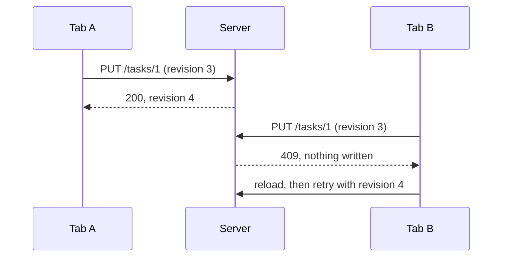

# Architecture

The app is an Express server ([server.ts](../server.ts)) that serves a React 19 + Vite frontend,
Gemini AI endpoints, and a Prisma-backed board API. Code is split into small modules so each
change needs only a narrow context.

## Frontend: dynamic loading

[App.tsx](../src/App.tsx) uses React Router for project-scoped view URLs and
browser history. [TaskPage.tsx](../src/components/TaskPage.tsx) independently
loads the owning project board for dedicated new/edit task routes in the current
tab, reusing [TaskModal.tsx](../src/components/TaskModal.tsx) in a non-modal layout.
Successful saves and cancellation return to the originating project/view stored
in router state, or to the owning board for direct links. The workspace remounts
and loads fresh data. Failed saves keep the editor and draft open.

```
App.tsx
 ├─ useProjects()               → GET /api/board/projects (summaries + stats only)
 └─ <Suspense>
     └─ lazy(CockpitView)     → action summaries + release metadata, auto-refresh
     └─ lazy(KanbanBoard)       → separate JS chunk, loaded on demand
         └─ useBoard(projectId) → GET /api/board/projects/:id/board in a useEffect
```

- [App.tsx](../src/App.tsx) loads only the project list. Project cards and the switcher use
  server-computed `stats` instead of all tasks.
- [CockpitView.tsx](../src/components/CockpitView.tsx) is the default, lazy-loaded landing
  view. It requests paginated action summaries and release metadata, not full session plans,
  ticket bodies, or all-project boards; only the selected ticket's project board is loaded
  when the user opens a ticket.
- [KanbanBoard.tsx](../src/components/KanbanBoard.tsx) is loaded with `React.lazy` and shown
  with a `Suspense` fallback, so the board code is not in the initial bundle.
- [useBoard.ts](../src/data/useBoard.ts) fetches the selected project's features and tasks in an
  effect. Switching projects aborts the previous request (`AbortController`), so stale
  responses never overwrite the current board.

## Atomic, entity-by-entity persistence

Each user action persists **only the entity it changes**, in its own transaction:

| Action | Request | Transaction scope |
|--------|---------|-------------------|
| Edit a task | `PUT /tasks/:id` | That task and its subtasks |
| Move a card | `POST /tasks/:id/move` | That task's status and column order |
| Enter In Progress | Move or edit task | Status change plus its durable agent session, in one transaction |
| Edit a feature | `PUT /features/:id` | That feature |
| Delete a feature | `DELETE /features/:id` | The feature, plus unlinking its tasks |
| AI breakdown | `POST /breakdown` | The feature and its generated tasks, all or nothing |

- [useOperation.ts](../src/data/useOperation.ts) tracks pending/error state **per operation**, so
  one component's failure or spinner does not reset another component's state (open modals,
  form input, selection).
- Local state is updated from the server response, which carries the new `revision`.
- [entityStore.ts](../server/db/entityStore.ts) implements the transactions;
  [boardStore.ts](../server/db/boardStore.ts) handles only initialization and reset.

## Ticket execution

[AgentProvider](../server/agents/provider.ts) abstracts the AI backend; the initial adapter is
[CopilotProvider](../server/agents/copilotProvider.ts). The
[session service](../server/agents/sessionService.ts) polls durable jobs, prepares per-ticket
worktrees, persists questions and answers, and waits for plan approval before enabling writes.
[SessionsView](../src/components/SessionsView.tsx) and the task session panel are lazy-loaded;
list queries return paginated metadata without full ticket contexts or plans.
See [agent sessions](./agent-sessions.md) for permissions, lifecycle and setup.

## Optimistic concurrency



Projects, features, and tasks have a `revision` column. Every update, delete, and move sends
the revision the client last saw:

1. The server updates the row only if the revision matches, then increments it.
2. If it does not match (another tab or client changed it), the server returns **409** and
   nothing is written.
3. The client shows the error; the user's draft and other components' state are kept.

## Module map

| Layer | Files |
|-------|-------|
| Schema | [prisma/schema.prisma](../prisma/schema.prisma) |
| Validation | [src/types/board.ts](../src/types/board.ts) (zod, shared by client and server) |
| Server stores | [entityStore.ts](../server/db/entityStore.ts), [boardStore.ts](../server/db/boardStore.ts) |
| Git | [server/git/repositoryService.ts](../server/git/repositoryService.ts), [RepositoryFields.tsx](../src/components/RepositoryFields.tsx), [BranchSwitcher.tsx](../src/components/BranchSwitcher.tsx) |
| Routes | [server/routes/board.ts](../server/routes/board.ts) |
| HTTP client | [src/data/boardApi.ts](../src/data/boardApi.ts) |
| Hooks | [useProjects.ts](../src/data/useProjects.ts), [useBoard.ts](../src/data/useBoard.ts), [useOperation.ts](../src/data/useOperation.ts) |
