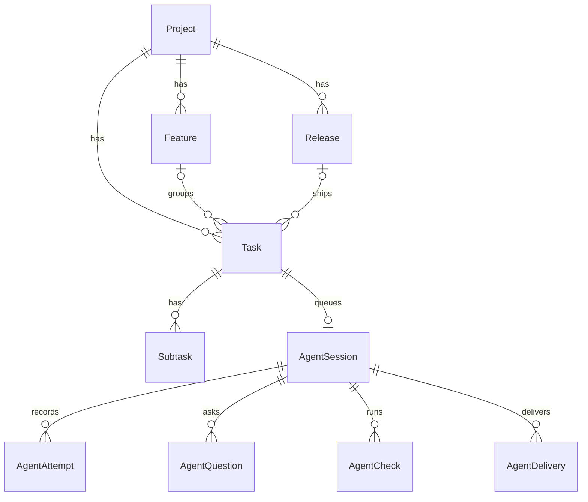

# Database

Entities are managed with **Prisma** on **SQLite**. The schema lives in
[prisma/schema.prisma](../prisma/schema.prisma).

## Entities

| Model | Key fields | Relations |
|-------|-----------|-----------|
| `Board` | `revision` | Singleton marking that the database is initialized. |
| `Project` | `id`, `position`, `revision`, `repositoryUrl`/`Branch`/`Commit` | Has features and tasks. Deleting a project cascades to both. |
| `Feature` | `id`, `projectId`, `status`, `position`, `revision` | Deleting a feature sets linked tasks' `featureId` to `null`; status is independent from linked task statuses. |
| `Task` | `id`, `projectId`, `featureId`, `status`, `position`, `revision` | Has subtasks. |
| `Subtask` | composite key `[taskId, id]`, `position` | Deleted with its task. |

The feature-status migration initializes existing epics from their linked tickets, then epic
and ticket statuses remain independent. `position` stores ordering. `revision` supports
optimistic concurrency (see [architecture](architecture.md#optimistic-concurrency)).



`ActivityEvent` is an append-only log that references entities by id, without foreign keys.

## Migrations

Migrations are committed in [prisma/migrations](../prisma/migrations).

```sh
make db-migrate                   # apply existing migrations
# edit prisma/schema.prisma, then:
make db-dev NAME=add_due_date     # create + apply a new migration, regenerate the client
```

Always commit the generated migration folder with the schema change.

## Inspecting and resetting

```sh
make db-studio   # visual browser/editor
make db-reset    # DESTRUCTIVE: drops all data and re-applies migrations
```

The app can also restore the demo dataset with `POST /api/board/reset`.

## Data import

On first load of an empty database, the browser's legacy localStorage data is imported via
`POST /api/board/initialize` with `{ legacy: { projects?, features?, tasks? } }`.
Only existing keys are sent; missing collections are filled on the server from
[the shared demo seed](../shared/data/initialData.ts), which is not bundled with the frontend.
Legacy missing project links and dangling feature links are normalized before validation.
An explicit empty features/tasks array stays empty; invalid data fails instead of falling back.
Full `{ projects, features, tasks, releases? }` imports remain supported without legacy repairs.
Once initialized, the database is authoritative; local browser keys are left untouched as a backup.

## Storage and backups

- The database file is `prisma/kanban.db` (ignored by version control).
- Back it up by copying the file while the server is stopped.
- In production, put it on persistent storage; ephemeral filesystems lose data on restart.
- There is no authentication: every client of a server shares one board.
