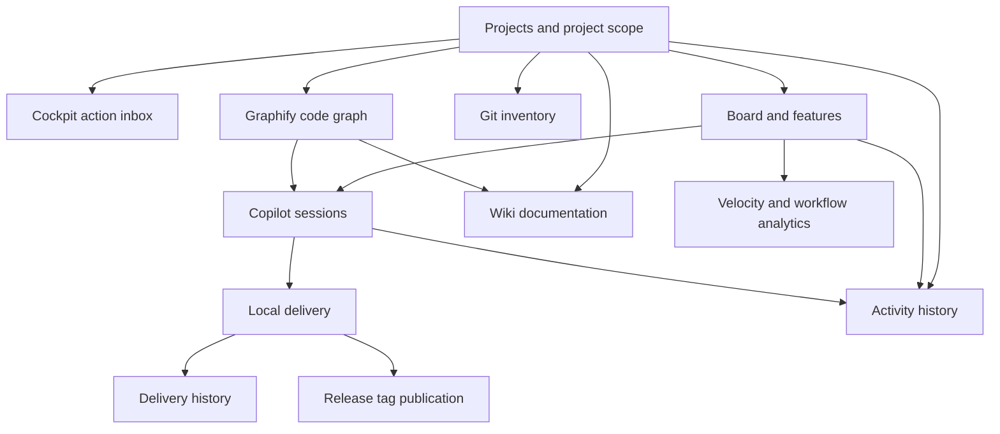

# Feature documentation

This index maps the top-menu views and the cross-cutting workflows that connect them.
Each page describes user-facing behavior and links to implementation and API details.

## Views (top menu)

| Feature | What it covers | Link |
|---|---|---|
| Cockpit | Action inbox, project pulse and release blockers | [Cockpit](cockpit/README.md) |
| Board | Kanban columns, cards and task movement | [Board](board/README.md) |
| Sessions | AI session list, action inbox and project health | [Sessions](sessions/README.md) |
| Deliveries | Local delivery attempt history | [Deliveries](deliveries/README.md) |
| Activity | Event list, 3D timeline and per-entity history | [Activity](activity/README.md) |
| Releases | Project versions, assignments and tag publication | [Releases](releases/README.md) |
| Wiki | Repository Markdown editor and folder tree | [Wiki](wiki/README.md) |
| Git | Read-only local repository and worktree inventory | [Git](git/README.md) |
| Code graph | Graphify knowledge-graph visualization and report | [Code graph](code_graph/README.md) |
| Analytics | Velocity, flow and bottleneck dashboard | [Analytics](analytics/README.md) |

## Cross-cutting features

| Feature | What it covers | Link |
|---|---|---|
| Projects | Portfolio, project switching, repositories and health | [Projects](projects/README.md) |
| Features | Feature/epic bar and Copilot breakdown | [Features](features/README.md#features-and-epics) |
| Tickets | Task editor, workflow, revisions and review/delivery pointers | [Tickets](tickets/README.md) |
| Navigation and filters | Header, sub-header, filters and quick actions | [Navigation and filters](navigation-and-filters/README.md) |
| Copilot | Session lifecycle, approvals, questions and provider | [Copilot](copilot/README.md) |
| Git integration | Clone workspaces, ticket worktrees, delivery and push policy | [Git integration](git-integration/README.md) |

## How the views relate

