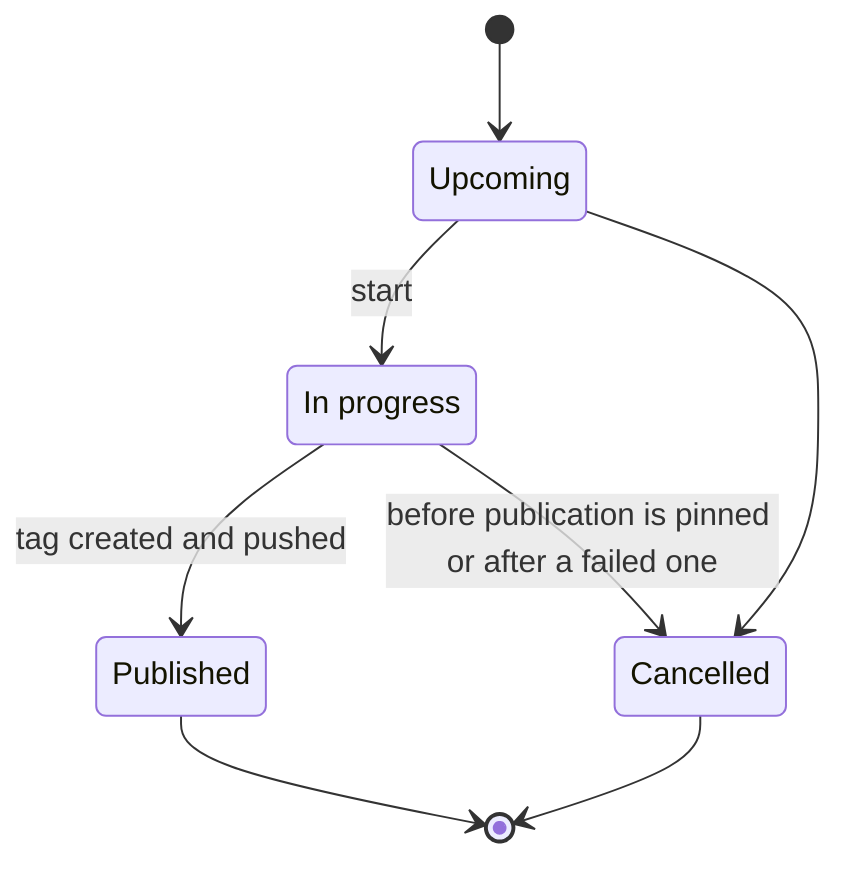
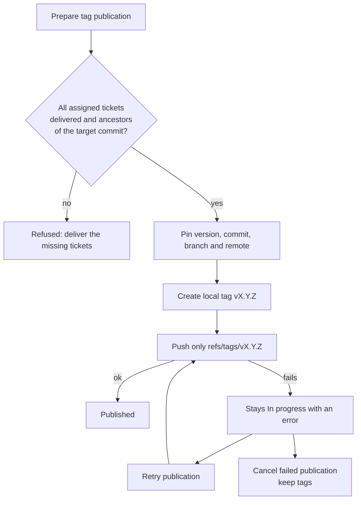

# Project releases

Open **Releases** for the selected project. The screen and ticket details load on demand;
release management does not add other tickets or full release contents to AI context.

Select **Show all** in the project switcher's menu for **All projects**: the release
list then aggregates every project's versions and labels them by project. Identical
version numbers in different projects stay distinct. Details, assignments and tag
publication always use the selected release's owning project. Choose an explicit
**Project for new release** before creating a version from this mode.

## Versions and statuses

- Versions use SemVer without a leading `v`: `1.2.0`, `1.2.0-rc.1`, `1.2.0+build.2`.
- The corresponding tag is exactly `v<version>`. Versions are unique within each project.
- Statuses are **Upcoming → In progress → Published**, or **Cancelled**.
- Create an Upcoming release, open it, then edit its version or move it to In progress.
- Published and Cancelled are final. Publication is the only way to become Published.
- Cancellation is available before publication is pinned, and after a failed publication
  with an explicit **keep tags** confirmation. Tickets of a cancelled release can be
  removed or reassigned to an active version.

## Ticket assignment and delivery

Each ticket can have one project release version. It may remain unassigned while being
planned or implemented, but **local delivery requires an Upcoming or In progress version**.
Choose a version in the task editor, in the local delivery panel, or with **Assign a ticket**
in the release detail. Versions from another project cannot be used.

Unassigned new tickets automatically use the project's **earliest-created Upcoming**
release (not the In progress release). Creating an Upcoming release also assigns existing
unassigned tickets, and startup reconciles unassigned tickets with existing Upcoming releases.
Existing assignments are never replaced. An epic's release is represented by its child
assignments; all children must share one active release before the epic can be finished.
When no Upcoming release exists, implementation and review can continue unassigned,
but Git **Finish** requires creating/assigning a release first.

Assignment is revision-checked. Active AI execution/delivery must finish before changing
assignment. Changing only the version does not invalidate an accepted plan or code review.
Both task-editor saves and the dedicated assignment endpoint enforce the same restrictions.

Release details list tickets, board statuses, delivery status and merge hashes. A ticket
manually moved to Done is **not** considered delivered. The latest session attempt must have
a successful local delivery or a completed **Finish** from the Git view. Publishing a
feature branch alone is not delivery into the project branch. Existing locally delivered
tickets can be assigned before publication; assignments recorded by Finish are pinned.

## Publication: only a tag

1. Move the release to **In progress**.
2. Deliver every assigned ticket locally, or Finish its published feature branch in Git.
3. Choose **Prepare tag publication**. The server verifies all deliveries are ancestors of
   the target commit, then displays the exact version tag, commit, branch and remote.
4. Confirm **Create tag & push release**.

The initial target is the current HEAD of the project's configured target branch in its
managed clone. Switch to that branch explicitly if needed. The tag covers that entire commit,
including any other work already integrated there; it does not cherry-pick only this release's
tickets. Empty releases can tag the target HEAD as well.

Publication creates a lightweight Git tag and pushes only `refs/tags/v<version>` to a single
HTTPS or SSH push URL of `origin`. No branch, unrelated tags, pull request, deployment,
test run or AI session is created. Tag pushing necessarily transfers its reachable Git
objects. Existing local/remote tags on another object are never overwritten or forced.
The source folder of a locally cloned project is never pushed to.

The server uses its existing SSH keys or Git credential helper, with terminal prompts
disabled. One-time clone access tokens are not stored or reused. A project with a local
folder origin or multiple origin push destinations must be reconfigured before publication.
Git pre-push hooks are skipped; publication adds no hidden validation step.

## Failure and retry

Before any tag write, SQLite records the target commit, branch and remote and pins the
release's version and membership. These stay frozen even if the network operation fails.
The local tag is retained; the release stays In progress with an explicit error.
Alternatively, **Cancel failed publication (keep tags)** stops retries and allows ticket
reassignment to a new version. Cancellation never deletes a local or remote tag, including
one the remote may already have accepted. The old version remains reserved.

Reload and choose **Prepare publication retry**. Retry uses the **original pinned commit**,
even if the branch has advanced. Restore the original origin if it changed; the application
will not silently push a retained release to a different destination.

After push, the exact remote tag is read back. Only successful verification changes the
release to Published. If the server stops after Git succeeds but before SQLite is updated,
restart leaves a recoverable error; an explicit retry recognizes the matching remote tag
and finalizes the release without overwriting it. No network write is automatically replayed.

Release publication, local delivery and project branch switching share a per-project
in-process Git lock. Context edits/deletes are briefly blocked while a tag is publishing.
Run only one server per database; these are not distributed leases.

This application has no authentication. Keep it private: anyone with API access could
trigger the explicit tag push with the server's credentials.
