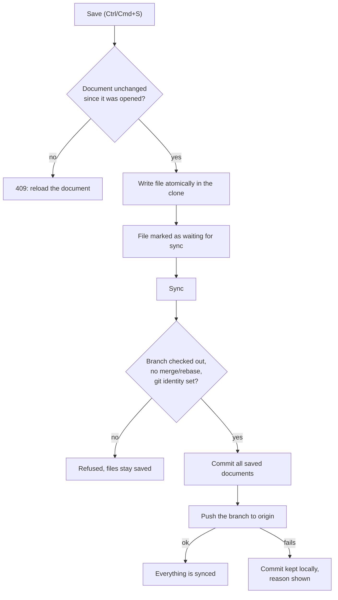

# Wiki

The **Wiki** view edits the Markdown files of a project's documentation folder and keeps them in
git. It appears only when the selected project has a git repository; it is not available in the
"Show all" scope.

## Documentation folder

- Set when creating a project that has a repository (default `doc`) and editable later from
  **Manage projects**. The value is stored in `Project.docsPath`.
- It must be a relative folder inside the repository (for example `doc` or `docs/wiki`). Absolute
  paths, `..`, backslashes and `.git` are rejected.
- The folder is created on the first save if it does not exist. Existing projects without a stored
  value use `doc`.

## Ticket documentation

Copilot adds a dedicated Markdown page to each ticket worktree under the configured docs folder:
`features/<feature-slug>/<ticket-slug>-<ticket-id-prefix>.md`, or
`features/tickets/<ticket-slug>-<ticket-id-prefix>.md` when no feature is assigned. Human review
cannot be accepted until that exact file has changed in the ticket and contains non-empty text.
The review panel shows the required path; Copilot is instructed to write the page during execution,
and a correction plan can add it if it is missing.

The page travels with the ticket's code changes. Once the reviewed ticket is delivered to the
project branch, it appears in the Wiki's folder tree. Use Wiki **Save** and **Sync** for later edits.
The optional AI review can inspect this document alongside the code diff.

## Saving and syncing

Saving and syncing are separate steps.



**Save** only writes the file in the project clone, atomically. Nothing is committed.

**Sync** commits every pending document of the docs folder in one commit on the branch currently
checked out (`docs: add|update <path>` or `docs: update N documents`), leaving any other local
change untouched, then pushes that branch to `origin` without forcing. Sync is disabled while the
open document has unsaved edits.

Knowing when to sync: the Wiki header shows **Everything is synced** or an amber summary such as
`2 saved changes to commit · 1 commit to push`, with a counter on the Sync button. Files waiting for
sync have an amber dot in the file tree, and the open document reads "Saved, waiting for sync".
"Commits to push" is computed against `origin/<branch>`; it is not shown when the origin is a
local folder, which is never pushed to.

If the push fails (no credentials, remote ahead, origin is a local folder), the commit is kept
locally and the UI shows why; sync again to retry. The push uses the server's SSH keys or git
credentials, never a stored token, and also sends any earlier unpushed commits of that branch.

Sync is refused when a merge/rebase is in progress, HEAD is detached, git `user.name`/`user.email`
are not configured, or a ticket delivery holds the project lock. Saved files remain on disk. Saved
but unsynced documents are uncommitted changes, so switching the project branch is refused until
you sync.

## Safety

- The file list is a folder tree: folders collapse, and the folder button creates one. Git does not track empty folders, so a new folder starts as a `README.md` page that exists once saved.
- ```` ```mermaid ```` blocks render as diagrams in the preview (lazy-loaded; an invalid diagram shows its error and source).
- Only `.md`, `.markdown` and `.mdx` files, up to 1 MB, at most 8 folders deep and 500 files listed.
- Hidden files/folders and `node_modules` are ignored; symbolic links are refused.
- Concurrent edits are detected with a content hash: saving a document that changed since it was
  opened returns `409` and offers to reload it.
- The preview renders Markdown with a built-in renderer that only creates React elements, so raw HTML
  in a document is displayed as text. Images are shown as placeholders.

Each sync is recorded in the project's [Activity history](activity-history.md) (`docs_saved`) with
branch, short commit and whether it was pushed. Document contents are not stored there.

## API

| Method | Path | Body / query | Result |
| --- | --- | --- | --- |
| `GET` | `/projects/:id/wiki` | | `{ docsPath, branch, files: [{ path, size, modifiedAt }] }` |
| `GET` | `/projects/:id/wiki/file` | `path` | `{ path, content, sha }` |
| `GET` | `/projects/:id/wiki/status` | | `{ pending: [{ path, status }], ahead }` (`ahead` is `null` when unknown or origin is local) |
| `PUT` | `/projects/:id/wiki/file` | `{ path, content, expectedSha }` (`null` for a new file) | `{ path, sha, unchanged }`; writes only, no commit |
| `POST` | `/projects/:id/wiki/sync` | `{}` | `{ branch, commit, files, pushed, pushError? }` |

Paths are relative to the documentation folder. Apply the migration with `make db-migrate`.
