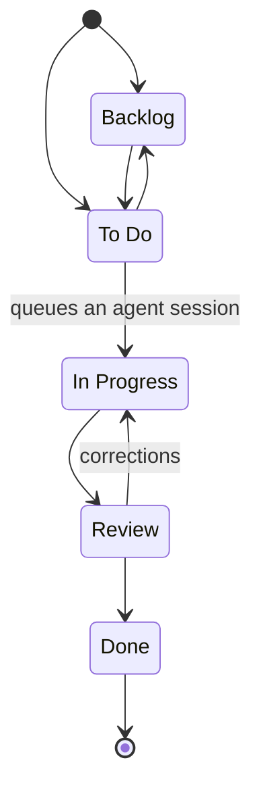

# Task workflow

Tasks move through the board columns following fixed rules:

| From | Allowed targets |
|------|-----------------|
| Backlog | To Do |
| To Do | Backlog, In Progress |
| In Progress | Review |
| Review | In Progress (corrections), Done |
| Done | — (final) |

- Epics use the same stage transitions. Moving an epic to **Backlog**, **To Do**, or
  **In Progress** synchronizes its tickets to that status.
- Moving an epic to **In Progress** queues every ticket for automatic sequential planning
  and execution; epic tickets do not wait for individual plan approval. Tickets then
  complete their own review and delivery cycle.
- A multi-ticket epic cannot enter **Review** while any ticket is unfinished. When the last ticket
  becomes **Done**, the epic moves to **Review** automatically; the ticket statuses remain
  **Done**.
- Successful agent execution moves its ticket to **Review**. A feature with exactly one
  ticket also moves to **Review** as soon as that ticket is ready for review, without
  waiting for delivery. Requesting corrections reopens the ticket and feature to **In Progress**.
  Failed or cancelled execution does not advance the ticket or feature.
- Reordering cards within the same column is always allowed.
- New tasks can only be created in **Backlog** or **To Do** (including tasks generated by the
  Copilot breakdown, which are placed in To Do unless proposed for Backlog).
- Demo data loaded by *Reset demo data* or the initial import is not subject to these rules.
- Entering **In Progress** on a standalone ticket queues a
  [ticket agent session](./agent-sessions.md): read-only planning, clarification questions,
  then execution only after explicit approval. Epic tickets instead execute sequentially
  without per-ticket approval when their epic enters **In Progress**.
- Returning **Review → In Progress** archives the prior attempt and prepares a fresh plan
  in the same ticket worktree. No unique-session conflict and no automatic execution.
- A non-empty **Blocked reason** marks a ticket blocked without changing its column.
  This is informational only: it does not prevent transitions, approval or AI replanning.
  Active sessions must first be cancelled before their ticket can be edited.
- Ticket dependencies are not implemented. Manual board transitions remain available;
  human acceptance alone does not move a ticket.
- **Local delivery** is a separate explicit action for an accepted, completed execution
  in In Progress or Review: commit on the ticket branch, then merge into the project clone.
  Only a successful merge moves that ticket to **Done** automatically. Failed or missing
  checks require explicit acknowledgment; a failed commit/merge never marks the ticket Done.
- A ticket must belong to an Upcoming/In progress project release before local delivery.
  Release publication is separate: all assigned tickets must actually be delivered, then
  an explicit action creates and pushes only the version tag. See [releases](./releases.md).

## Where the rules apply

The rules live in one place, `WORKFLOW_TRANSITIONS` in
[src/utils/kanbanLogic.ts](../src/utils/kanbanLogic.ts), and are used by:

| Place | Behavior |
|-------|----------|
| Column hover | Columns glow in their header accent color on hover, including when dragging over an allowed column. Forbidden columns stay dimmed without a glow. |
| Drag and drop | While dragging, droppable target columns glow in their own header accent color and forbidden columns are dimmed; drops on forbidden columns are refused. |
| Card arrows and stage select | Only reachable stages are offered. |
| Task modal | The *Workflow Stage* select lists reachable stages (creation: Backlog / To Do). Column "+" buttons appear only on Backlog and To Do. |
| API | `POST /tasks`, `PUT /tasks/:id`, and `POST /tasks/:id/move` return `422` for a forbidden transition. The server is the source of truth. |

To change the workflow, edit `WORKFLOW_TRANSITIONS` (and `CREATION_STATUSES`); the UI and the
API follow automatically.
