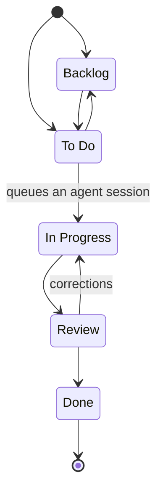
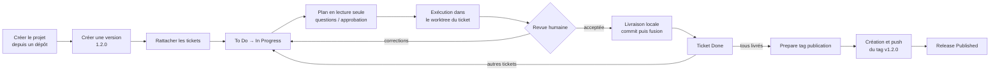

# Workflow Git : tickets, livraisons et releases

Ce document décrit le fonctionnement effectivement mis en place dans Kanban Flow Copilot.
Les libellés des boutons sont conservés en anglais pour correspondre à l'interface.

## 1. Principes

Le fonctionnement est un **workflow par ticket avec intégration locale et publication par tag**.
Ce n'est pas le Git Flow classique : l'application ne crée pas automatiquement de branches
`develop`, `feature/*`, `release/*` ou `hotfix/*`.

Trois opérations sont distinctes :

| Opération | Effet |
|-----------|-------|
| Exécution d'un ticket | L'IA travaille dans une branche et un worktree isolés, après approbation du plan. |
| Livraison locale | Un humain déclenche un commit du ticket, puis sa fusion dans la branche cible du clone du projet. |
| Publication d'une release | Un humain déclenche la création d'un tag de version, puis le push de ce seul tag vers `origin`. |

**Une livraison n'est pas un push. Une release n'est pas un déploiement.**

## 2. Dépôt source et clone du projet

À la création d'un projet, l'application clone un dépôt distant HTTPS/SSH ou un dossier Git
local autorisé. Le clone géré par le serveur se trouve dans :

```text
<WORKSPACES_DIR>/<project-slug>/
```

Par défaut, `WORKSPACES_DIR` vaut `./workspaces`.

- Le clone possède sa propre branche courante, choisie à la création du projet.
- Un dossier source local est copié sans partager de liens physiques ; ses modifications
  non commitées ne sont pas importées.
- L'exécution et la livraison locale ne modifient jamais le dépôt source.
- La publication d'une release écrit sur le dépôt distant, mais uniquement en poussant son tag.
- Si `origin` pointe vers un dossier local, la publication est refusée : l'application
  ne pousse pas de tag vers le dossier source.

Le gestionnaire de projets permet de changer de branche dans le clone. Le changement est
refusé si le clone contient des modifications non commitées. La liste provient des branches
déjà connues du clone : il n'y a pas de `fetch` ou de `pull` automatique.

### Vue Git du projet

L'onglet **Git**, disponible aussi sur mobile, suit le projet sélectionné dans
le sélecteur principal : URL source, chemin du clone, branche/commit réellement présents
et branche configurée. Il liste tous les worktrees enregistrés par Git, pas
seulement ceux des sessions IA, avec accès au ticket associé lorsqu'il existe.
L'onglet est masqué pour les projets sans dépôt ; les sélectionner depuis la vue
Git ramène au tableau Kanban. Aucun filtre projet supplémentaire n'est affiché.
Le bouton **Show all**, à côté de **Switch Project** dans le menu principal,
sélectionne **All projects**. Ce mode regroupe tableau, statistiques, sessions,
releases et dépôts Git de tous les projets. L'onglet Git y est disponible dès
qu'au moins un projet possède un dépôt. Les modifications conservent le projet
d'origine ; les créations nécessitent de choisir un projet réel.
Les worktrees externes, détachés, verrouillés ou devenus introuvables restent
visibles ; un clone indisponible affiche sa propre erreur.
La recherche et **Refresh Git inventory** facilitent le suivi.
Cette vue est en lecture seule : ni accès réseau, ni changement de branche,
ni nettoyage automatique. L'URL est la source mémorisée du projet.

## 3. Cycle d'un ticket et isolation Git

### Statuts du tableau



Les nouveaux tickets commencent en **Backlog** ou **To Do**.

Lorsqu'un ticket passe à **In Progress**, une session IA est enregistrée dans la même
transaction que le changement de statut. Le traitement de la session prépare :

- une branche `kanban/<session-id>` ;
- un worktree dédié ;
- un commit de base ;
- un contexte limité au ticket, à son projet et à sa feature/epic éventuelle.

Le worktree est placé dans :

```text
<WORKSPACES_DIR>/<project-slug>/.git/kanban-worktrees/<task-slug>/
```

La branche de départ est celle du projet capturée lors du démarrage du ticket. Elle devient
la **branche cible de livraison de ce ticket**. Changer ensuite la branche courante du
projet ne redirige pas silencieusement les tickets existants.

### Planification et exécution

1. L'IA prépare un plan en lecture seule.
2. Si nécessaire, elle pose des questions auxquelles l'utilisateur peut répondre.
3. **Approve plan & execute** autorise explicitement l'exécution.
4. L'IA peut modifier les fichiers du worktree et lancer les scripts existants
   `npm run test` et `npm run lint`.
5. La session se termine avec un rapport et des résultats de vérification distincts.

L'IA ne dispose pas d'un outil de commit, de fusion ou de push.
Une session **Completed** ne signifie pas que les tests ont réussi.

## 4. Revue humaine et corrections

**Open code review** compare le commit de base avec les fichiers actuels du worktree :
fichiers ajoutés, modifiés ou supprimés, y compris les ajouts non ignorés par Git.

La comparaison propose :

- une vue côte à côte avant/après ;
- une vue unifiée ;
- les numéros de ligne et les différences colorées ;
- une ouverture en plein écran ;
- le chargement à la demande du fichier sélectionné.

Pour accepter, l'utilisateur confirme les critères d'acceptation et la prise en compte
des résultats de vérification, puis choisit **Accept human review**.

L'acceptation porte sur une empreinte du contenu et une version de session. Si les fichiers
changent, elle ne valide pas les nouveaux changements : il faut recharger et accepter la
revue actuelle, ou demander une nouvelle tentative de correction.

**Request a correction plan** relance une planification en lecture seule dans le même worktree.
Un ticket en Review revient alors en In Progress. Le retour manuel **Review → In Progress**
prépare également une nouvelle tentative, sans exécution automatique.

Les tentatives précédentes sont archivées avec leurs plans, rapports, questions, vérifications,
revues et éventuelles livraisons.

## 5. Rattachement à une version

Chaque ticket peut être rattaché à **une seule version de release**, dans son propre projet.

La version :

- peut être absente pendant la préparation ou l'implémentation ;
- est **obligatoire avant la livraison locale** ;
- doit être **Upcoming** ou **In progress**, sans publication déjà préparée ;
- peut être sélectionnée dans l'éditeur de ticket, le panneau de livraison ou la vue Releases.

Changer uniquement la version ne rend pas le plan ou la revue du code obsolète.
Le rattachement ne peut cependant pas être modifié pendant une exécution ou une livraison active.

## 6. Livraison locale : deux actions explicites

Après la revue acceptée, ouvrir **Open local delivery** depuis le ticket ou la vue Sessions.
La livraison est possible pour un ticket en **In Progress** ou **Review**.

### Conditions

- Session d'exécution terminée et revue humaine acceptée.
- Contenu toujours conforme au contenu accepté.
- Version de release valide affectée au ticket.
- Branche cible du ticket actuellement sélectionnée dans le clone du projet.
- Clone cible propre, y compris les fichiers non suivis.
- Aucune fusion, rebase ou autre opération Git incompatible en cours.
- Identité Git auteur/committer configurée pour l'utilisateur du serveur ou pour le clone.

Si les derniers tests ou le dernier lint de la tentative sont absents ou en échec, une
**confirmation explicite supplémentaire** est obligatoire. Les résultats d'une ancienne
tentative ne sont pas considérés comme la validation de la tentative actuelle.

### Étape 1 : commit sur la branche du ticket

**Commit reviewed changes** :

1. affiche la cible, les avertissements et le message de commit ;
2. demande confirmation ;
3. crée un commit de tous les changements revus sur `kanban/<session-id>`.

Le ticket ne passe pas encore à Done, la branche cible n'est pas fusionnée et rien n'est poussé.

L'aperçu utilise un index Git temporaire. Une mise en staging partielle contenant un état
distinct du parent et du contenu revu est refusée plutôt que supprimée. Les commits créés
portent un identifiant de livraison et le trailer de co-auteur Copilot.

### Étape 2 : fusion et passage à Done

**Merge & mark Done** :

1. demande une deuxième confirmation ;
2. prépare la fusion avant de toucher aux fichiers du clone cible ;
3. crée un commit de fusion avec la cible et le commit du ticket comme parents ;
4. avance la branche cible sur cette fusion ;
5. enregistre la livraison et passe automatiquement le ticket à **Done**.

Les métadonnées du projet et le passage à Done sont persistés ensemble en base.

Exemple simplifié, pour une branche cible appelée `main` :

```text
Clone du projet

main                   A-------------------M
                        \                 /
kanban/<session-id>       T----------------

A : commit de départ
T : commit explicite du ticket
M : commit de fusion créé lors de la livraison
```

`main` est un exemple : le nom de la branche cible dépend du projet.

### Conflits et interruptions

En cas de conflit, la fusion n'est pas appliquée au clone cible. Le commit du ticket est
conservé et une erreur est affichée. La divergence doit être résolue localement avant de
recharger la livraison et de réessayer explicitement.

Les commits préparés sont enregistrés pour permettre une reprise après interruption,
sans créer un nouveau commit ou une nouvelle fusion à chaque essai.

Si Git réussit juste avant une panne de base de données, le ticket peut ne pas être encore
Done : recharger et relancer explicitement la livraison permet de réconcilier cet état.
Aucune écriture Git n'est rejouée automatiquement au redémarrage.

**Attention : déplacer manuellement un ticket vers Done reste possible, mais ne constitue
pas une livraison Git. La publication d'une release exige une livraison réellement enregistrée.**

## 7. Releases : version et tag uniquement

La vue **Releases** gère les versions du projet sélectionné.

### Versions et statuts

| Statut métier | Libellé de l'interface | Signification |
|---------------|-----------------------|---------------|
| À venir | Upcoming | Version préparée, tickets rattachables. |
| En cours | In progress | Version active, publication possible lorsque ses tickets sont livrés. |
| Publiée | Published | Tag poussé et vérifié sur le dépôt distant. |
| Annulée | Cancelled | Version finale abandonnée ; ses tickets peuvent être réaffectés. |

```text
Upcoming -> In progress -> Published
    |            |
    +------------+------> Cancelled
```

Il n'y a pas de retour de In progress vers Upcoming. Published et Cancelled sont finaux.
Seule une publication réussie peut donner le statut Published.

Les versions sont uniques par projet et suivent SemVer, sans préfixe `v` dans le champ version :

| Version | Tag créé |
|---------|----------|
| `1.2.0` | `v1.2.0` |
| `1.2.0-rc.1` | `v1.2.0-rc.1` |
| `1.2.0+build.2` | `v1.2.0+build.2` |

Aucune branche `release/*`, note de release distante ou release GitHub n'est créée.
Le tag est un **tag léger**, non un tag annoté ou signé.

### Conditions de publication

- La release est **In progress**.
- Tous les tickets rattachés ont une livraison locale réussie pour leur dernière tentative.
- Le commit visé contient réellement les commits de fusion de ces tickets.
- Le clone est positionné sur la branche cible configurée pour le projet.
- `origin` possède une seule URL de push, en HTTPS ou SSH, et non un chemin local.
- Les éventuels tags locaux ou distants du même nom pointent déjà sur l'objet attendu,
  sinon la publication est refusée.

Une release sans ticket peut également servir à taguer le HEAD cible.

### Publication

1. Choisir **Prepare tag publication**.
2. Vérifier le tag, le commit exact, la branche et l'URL distante affichés.
3. Confirmer **Create tag & push release**.
4. L'application crée le tag local et pousse **uniquement ce tag**.
5. Elle relit le tag distant pour vérifier qu'il désigne le commit attendu.
6. La version devient **Published** uniquement après cette vérification.

La cible initiale est le **HEAD de la branche cible actuelle du projet** dans son clone.
Elle peut différer de la branche de départ d'un ancien ticket ; les livraisons doivent alors
quand même être présentes dans son historique.

Le tag désigne le commit entier : il inclut les autres changements déjà intégrés sur cette
branche, pas seulement les tickets de la release. Il n'y a pas de cherry-pick automatique.

Exemple après livraison de plusieurs tickets :

```text
Clone : branche cible          A---M1---M2
                                       ^
                                       v1.2.0
                                       |
                                       +--- push de ce tag uniquement ---> origin
```

La branche distante n'est pas avancée. Le push du tag transfère néanmoins les objets Git
nécessaires pour rendre son commit et son historique accessibles sur le dépôt distant.

### Échec du push et reprise

Avant la création du tag, l'application enregistre et fige :

- la version ;
- les tickets rattachés ;
- la branche et le commit de publication ;
- l'URL distante.

Si le push échoue :

- la release reste **In progress**, avec une erreur ;
- le tag local est conservé ;
- **Prepare publication retry** reprend sur le commit initial, même si la branche a avancé ;
- un changement d'URL `origin` est refusé pour cette reprise ;
- un tag existant sur un autre objet n'est jamais écrasé.

Si le dépôt distant a accepté le tag mais que le serveur s'est arrêté avant d'enregistrer
le succès, la reprise vérifie le tag déjà présent et finalise la publication.

Après un échec, **Cancel failed publication (keep tags)** permet aussi d'abandonner la version.
Cette action ne supprime aucun tag, local ou distant. Les tickets peuvent être réaffectés,
mais l'ancienne version reste réservée et ne peut plus être publiée par cette release.

## 8. Authentification et garde-fous

- Git s'exécute avec les permissions de l'utilisateur du serveur.
- Le push utilise ses clés SSH ou son gestionnaire d'identifiants Git HTTPS.
- Un jeton fourni uniquement pour le clonage n'est pas conservé ni réutilisé pour le push.
- Les demandes d'authentification interactives sont désactivées.
- Les opérations de branche, de livraison et de publication partagent un verrou par projet
  dans le processus serveur.
- Les hooks de commit et la signature ne sont pas exécutés pour les commits de livraison ;
  les hooks pre-push sont ignorés pour la publication du tag.
- Les versions de données et les empreintes détectent les aperçus devenus obsolètes.
- Il n'y a ni force push, ni écrasement de tag, ni résolution automatique de conflit.

Le worktree n'est pas un bac à sable : les scripts de test/lint et certaines configurations
Git peuvent exécuter du code avec les permissions du serveur.

L'application n'a pas d'authentification utilisateur. Elle doit rester sur un environnement
privé et de confiance. Utiliser **un seul serveur par base de données** : les verrous ne sont
pas distribués et ne remplacent pas une coordination entre plusieurs instances.

## 9. Parcours utilisateur recommandé



1. Créer le projet à partir d'un dépôt et choisir sa branche cible.
2. Dans Releases, créer une version, par exemple `1.2.0`.
3. Rattacher les tickets à cette version.
4. Passer un ticket de To Do à In Progress.
5. Répondre aux questions éventuelles et approuver son plan.
6. Examiner les changements et les résultats test/lint.
7. Demander des corrections si nécessaire, sinon accepter la revue humaine.
8. Livrer localement : commit du ticket, puis fusion et passage à Done.
9. Répéter pour les autres tickets.
10. Passer la release à In progress, vérifier son périmètre et préparer la publication.
11. Confirmer la création et le push du tag.
12. Vérifier le statut Published.

## 10. Références

- [Dépôts Git et changement de branche](./doc/git-repositories.md)
- [Sessions IA, revue et livraison locale](./doc/agent-sessions.md)
- [Gestion des releases et reprise de publication](./doc/releases.md)
- [Transitions des tickets](./doc/workflow.md)
- [API](./doc/api.md)
